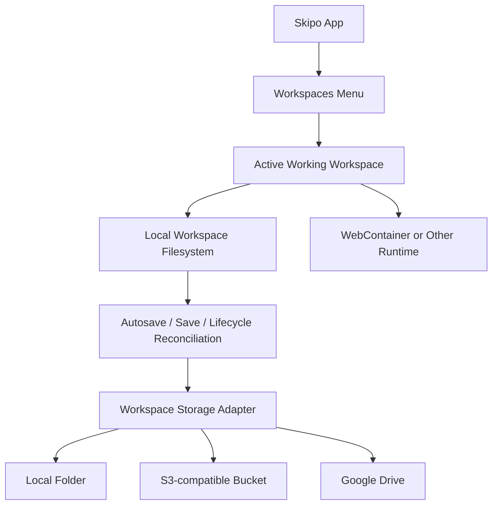
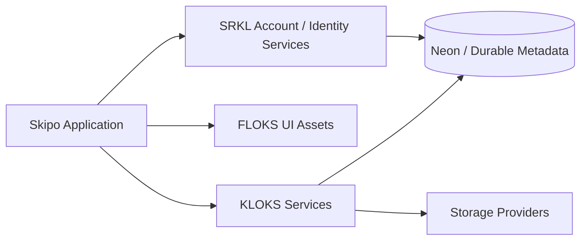

# SKIPO APPLICATION CONTRACT

This is the canonical entry point for an agent or developer creating a new Skipo application.

> **Authority rule:** SKIPO defines how an application is built. KLOKS defines reusable backend infrastructure consumed by that application. FLOKS defines reusable UI assets. Application code must consume those systems through their public contracts rather than redefining them.

## 1. Application shape

```text
Skipo App
├── src/frontend/                 client presentation
│   └── main.tsx                  canonical Vite browser bootstrap
│   └── pages/
│       ├── auth/                 mandatory authentication surface
│       ├── menus/
│       │   └── workspaces/       mandatory workspace selector
│       ├── main/
│       │   └── tabs/             application-specific working UI
│       └── settings/
│           └── tabs/
│               ├── themes/       mandatory
│               └── accounts/     mandatory SRKL account surface
│
├── src/backend/                  backend plane
│   ├── <AppName>Backend.ts       single frontend backend facade
│   ├── adapters/                 runtime/protocol adapters
│   ├── orchestrations/           thin service sequencing
│   ├── services/                 service facades + implementations
│   └── gateway/                  remote service gateway
│
├── src/libraries/                environment-neutral code
├── src/frontend-state/           Zustand state + events
├── tests/                        architecture/unit/integration/e2e tests
├── config/                       boundary/build configuration
└── .github/workflows/            CI validation/build
```

For Vite applications, root `index.html` loads `src/frontend/main.tsx`; that file mounts the frontend app and is the only canonical Vite browser bootstrap. The universal backend Fetch ingress remains `src/app.ts` and is not a frontend entrypoint. The detailed backend/runtime boundary rules are defined by [APP_ARCHITECTURE_SPEC](../app-architecture-spec/SKILL.md). The frontend contract is enforced by checklist 19.

## 2. Workspace and storage model

Every Skipo app exposes the same workspace abstraction. A selected workspace has an active local working representation; persistence is an adapter concern.



Canonical details: [Workspace Storage Architecture](../workspace-architectures/SKILL.md).

**Invariant:** application code does not directly implement provider-specific storage access. Provider credentials and APIs remain behind the storage service/adapter boundary.

## 3. Ecosystem boundaries



- **SKIPO:** application structure, runtime contract, workspace contract, agent guidance, generators, validators.
- **KLOKS:** reusable backend infrastructure and service implementations.
- **FLOKS:** reusable Frnl UI components/pages.
- **SRKL:** ecosystem account/service-account capabilities used by applications.
- **Neon:** durable control-plane metadata; workspace payloads remain in the selected storage system according to the workspace contract.

## 4. Agent workflow

An agent creating or modifying a Skipo application MUST follow this order:

1. Read this contract.
2. Run `python3 assistant.py advise "<task>"`.
3. Load the linked domain SKILL.md files returned by the router.
4. Use the appropriate `assistant.py generate ...` command for new structural artifacts. Graph applications MUST also load [Graph Application Contract](../graph-application-contract/SKILL.md).
5. Implement business-specific logic only inside the generated architectural boundaries.
6. Run the relevant checklist(s).
7. Run `python3 assistant.py validate .`.
8. Run the repository test/build commands and CI.
9. Do not declare the application complete while a blocking validator or CI job fails.

## 5. Generator map

| Need | Generator |
|---|---|
| Component | `generate component <path> --name <Name>` |
| Entity/functionality | `generate entity <path> --name <Name>` |
| Service | `generate service <name>` |
| Route | `generate route <path> --name <Name>` |
| Workspace storage | `generate storage <path>` |
| Application structure | `generate app-structure <path> --name <Name>` |
| Full sub-app | `generate subapp <path> --name <Name>` |
| Multi-target app | `generate multi-target <path> --name <Name>` |

Use `assistant.py advise` rather than guessing a generator when the task does not map directly.

## 6. Runtime and deployment

The application runtime model is:

```text
CLIENT + LOCAL   valid
SERVER + LOCAL   valid
SERVER + REMOTE  valid
CLIENT + REMOTE  invalid
```

The frontend imports the single backend facade rather than service internals. Runtime-specific implementations stay behind service facades and adapters.

Canonical specifications:
- [Application Architecture](../app-architecture-spec/SKILL.md)
- [State & Execution](../state-execution-spec/SKILL.md)
- [Multi-Target Build](../multi-target-build-spec/SKILL.md)
- [Backend Architecture](../../backend/SKILL.md)

## 7. Completion gate

```text
Task complete
    ⇓
assistant.py validate .
    ⇓
all blocking checklists pass
    ⇓
tests/build pass
    ⇓
GitHub CI passes
```

The validator is authoritative for machine-checkable architecture. This document is the canonical orientation layer for humans and coding agents.


## 8. Guest-mode framework contract

Guest access is standard access in a reduced state with no persistent workspace. It is NOT a separate system. There are NO extra code assets like separate UIs or separate backend lease systems.

- "Continue as guest" (via `onContinueAsGuest` on `LuthAuthPage` or `LoginGate`) is the ONLY extra UI for it.
- Guest mode creates no durable workspace, no synthetic identity, no Luth session, and no application-local authentication authority.
- No separate guest UI components (e.g., `GuestAccessGate.tsx`) are permitted.
- No separate backend guest lease endpoints (e.g., `/api/guest/lease`, `/api/auth/guest/session`) or separate guest authorities exist.
- Guest access operates in an in-memory, client-reduced state without persistent workspace storage.
