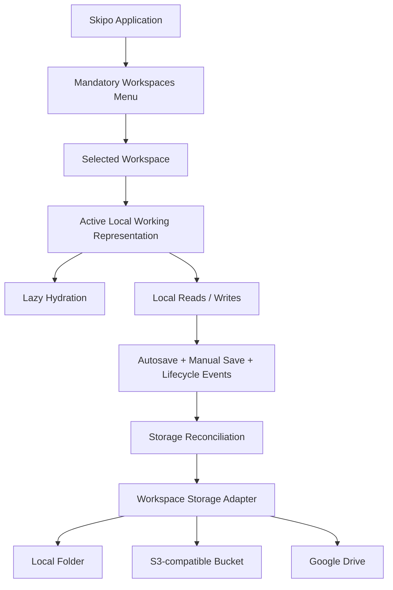
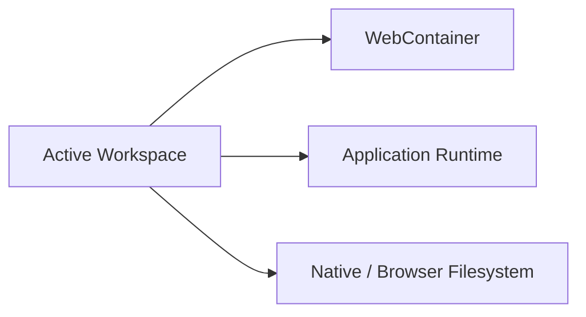

# Unified Workspace & Storage Architecture

Every Skipo application uses one workspace abstraction. The selected persistence provider changes where durable workspace data is stored; it does not change the application workspace model.

## 1. Architecture



The filesystem representation is the canonical project data model. A second workspace manifest is not required.

## 2. Workspace lifecycle

```text
SELECT
  ↓
OPEN ACTIVE LOCAL WORKSPACE
  ↓
HYDRATE REQUIRED FILES
  ↓
READY
  ↓
LOCAL READS / WRITES
  ↓
AUTOSAVE + IMPORTANT LIFECYCLE EVENTS + MANUAL SAVE
  ↓
PERSISTENT STORAGE RECONCILIATION
```

Large binary assets are hydrated lazily. Opening or switching workspaces does not require downloading the complete workspace.

## 3. Persistence providers

| Provider | Role |
|---|---|
| Local Folder / OPFS | Active local working representation and local persistence |
| S3-compatible Bucket | Durable bucket-backed persistence (including providers such as Backblaze B2) |
| Google Drive | User-authorized durable workspace persistence |

Provider-specific credentials, OAuth, APIs, and synchronization logic stay behind the workspace storage adapter/service.

**Application invariant:** Skipo application code never reads or writes a provider directly.

S3-compatible bucket storage is a selectable Skipo workspace provider. All provider-specific SDKs and credentials remain behind the canonical Kloks storage service.

## 4. Runtime relationship

WebContainers may consume the active workspace, but WebContainers do not define the workspace abstraction.



## 5. Change detection and reconciliation

Filesystem metadata such as modification time and size is the cheap change test. Content hashes are used when verification is required. Reconciliation is responsible for resolving changes between the active local representation and the selected persistent provider.

Redundant clones are replication/backup mechanisms; they do not create a second logical workspace.

## 6. Related contracts

- [Skipo Application Contract](../app-architecture/SKILL.md)
- [Backend Architecture](../../backend/SKILL.md)
- [State & Execution](../state-execution-spec/SKILL.md)


## 7. Workspace Creation UI Ownership

The workspace creation dialogue is a Floks-owned UI contract. Applications MUST
import and render `WorkspaceCreateDialog` (normally through
`WorkspaceTilesMenu`) from `@ultrst-armada/floks/ui`. Applications may adapt
the emitted `WorkspaceCreateInput` to their own workspace API, authentication
boundary, and storage service; they MUST NOT create app-local workspace
creation forms or duplicate the dialogue's layout, fields, validation, provider
selection, or canonical folder preview.

Every Skipo scaffold and the minimal scaffold generator MUST ship the Floks
workspace gate and connect the current user's authorized storage connections
to it. Changes to the dialogue's presentation or creation contract are made in
Floks first and consumed through its published package version.
