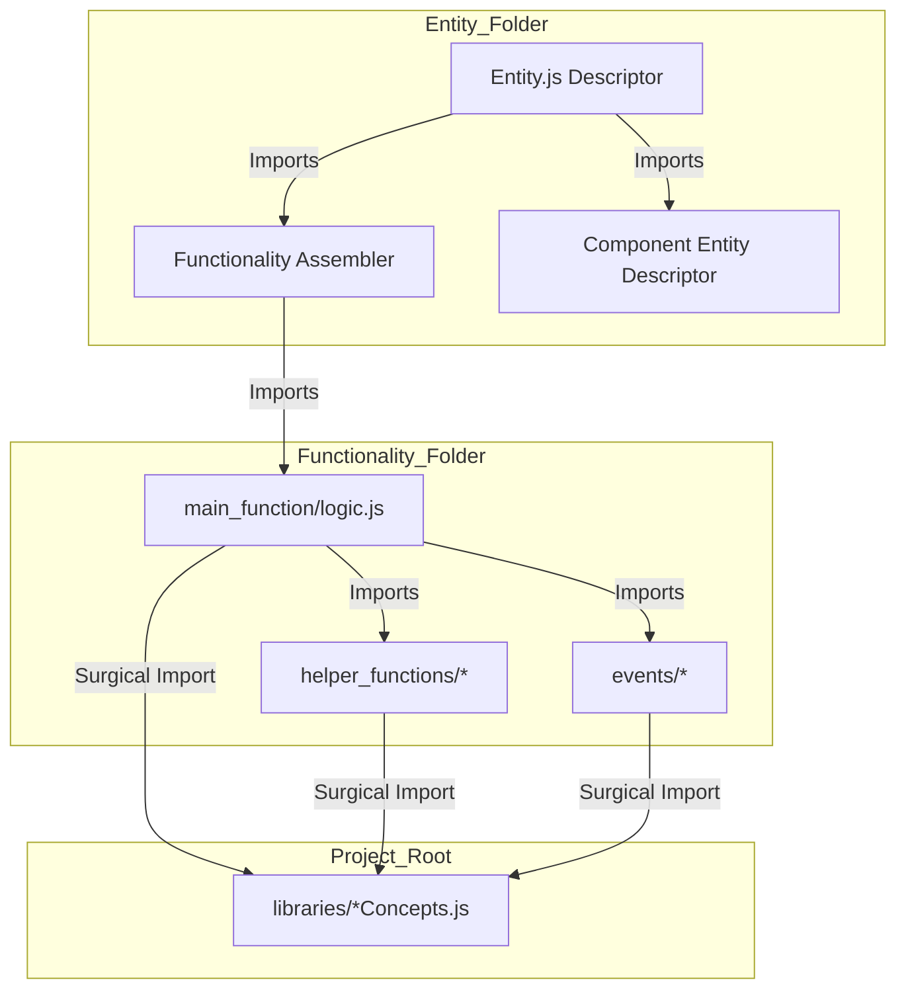

# Ultrst Project Structure: Canonical Guide

By **Dinil Palackal**

This document defines the strict physical and logical organization of a Krnl project. The goal is **Atomic Separation**: code is partitioned into directories such that logic is isolated, interfaces are explicit, and dependencies are surgical.

---

## 1. The Global Scaffolding

A project consists of a single root server and a tree of entities. Libraries exist **only** at the very top.

```text
/MyProject/
├── libraries/                 <-- PROJECT ROOT ONLY
│   └── [Subject]Concepts.js   <-- Shared data/logic atoms
├── entities/                  <-- Root components
│   └── Display/
│       ├── entities/          <-- Nested components
│       ├── functionalities/   <-- Display logic
│       └── Display.js         <-- Descriptor
├── functionalities/           <-- Root logic
│   └── Auth/
│       ├── main_function/
│       ├── helper_functions/
│       ├── events/
│       └── Auth.js            <-- Assembler
└── MyProjectServer.js         <-- Root Descriptor (Server)
```

---

## 2. The Import Flow (Surgical Model)

Logic atoms do not "bubble up" imports. Instead, the **Main Function** acts as the surgical integration point.



---

## 3. Mandatory Scaffolding Rules

1.  **Libraries Folder**: Only allowed in the project root. Component entities **cannot** have their own libraries folder.
2.  **Entity File**: Must be a **Pure Descriptor**. It defines the Interface (IO) and assembles logic. It contains **no spare functions**.
3.  **Functionality Root**: An assembler that only imports the `main_function/logic.js`.
4.  **Implementation Files**: (Main Function, Helpers, Events) are the **only** places where libraries are imported.

---

## 4. Examples of Nested Scaffolding

### Example 1: The Root Level (Server)
The root always extends `krnlSystemEntityBase`.

```text
/RootServer/
├── libraries/
│   └── SystemConcepts.js
├── entities/
├── functionalities/
└── RootServer.js (Extends krnlSystemEntityBase)
```

### Example 2: First-Level Component (Engine)
Components extend `krnlEntityBase`.

```text
/RootServer/entities/Engine/
├── entities/
│   └── Piston/ (Further Nesting)
├── functionalities/
│   └── Ignition/
│       ├── main_function/
│       ├── helper_functions/
│       ├── events/
│       └── Ignition.js
└── Engine.js (Extends krnlEntityBase)
```

### Example 3: Deeply Nested Component (Piston Sensor)
Even at the 3rd level of nesting, the scaffolding remains identical.

```text
/RootServer/entities/Engine/entities/Piston/
├── entities/
├── functionalities/
│   └── PressureCheck/
│       ├── main_function/logic.js (Imports ../../../../../libraries/SystemConcepts.js)
│       ├── helper_functions/
│       ├── events/
│       └── PressureCheck.js
└── Piston.js (Descriptor)
```

---

## 5. Summary of Surgical Imports

| Level | Can Import Libraries? | Rationale |
| :--- | :---: | :--- |
| **Entity Descriptor** | **NO** | Should only care about IO and assembly. |
| **Functionality Root** | **NO** | A configuration object for the logic atom. |
| **Main Function** | **YES** | The primary logic executor. |
| **Helper Functions** | **YES** | Specific utility logic. |
| **Events** | **YES** | Lifecycle reactions. |

This ensures that the **Logical Architecture** is perfectly mirrored by the **Physical File System**.
