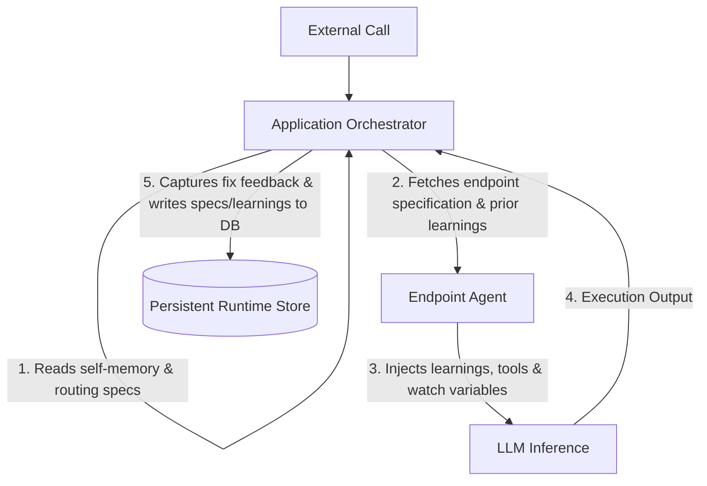

# KrnlTS Agentic Layer & AI Orchestration

KrnlTS provides an integrated AI layer. Downstream apps can run fully autonomous agents on any endpoint without manual boilerplate, incorporating persistent memory and dynamic tool execution.

## 1. Defining Agentic Endpoints (`KrnlEndpointDefinition`)
Rather than legacy configs, endpoints are declared as unified `KrnlEndpointDefinition` objects:
```typescript
interface KrnlEndpointDefinition {
  id: string;                         // Unique endpoint path name
  method: "POST" | "GET";
  category: "app" | "krnl_system";    // Apps are editable; systems are read-only
  description?: string;
  systemInstructions?: string;        // Agent system prompt override
  inputSchema?: any;                  // Zod or JSON input schema
  examplePayload?: any;               // Example input data
  agentTools?: string[];              // Names of tools this agent can use
  dynamicWatchVars?: string[];        // Variables that trigger real-time changes
  staticWatchVars?: string[];         // Read-only variables injected into context
  memory?: string;                    // Persistent learnings (endpoint-specific)
  intelligenceSpec?: KrnlIntelligenceSpec; // Requirements (reasoning, coding, summaries, etc.)
}
```

---

## 2. Built-in Tools Kit (`K_LIB_Krnl_Ep_Tools.ts`)
Each agent has standard tools available if registered in `agentTools`:
*   `calculator`: Solves math queries.
*   `jsonCreator`: Sanitizes outputs to valid JSON structure.
*   `textFormatter`: Structures reports or markdown.
*   `endpointCaller`: Dynamically triggers other endpoints within the ecosystem.
*   `healthChecker`: Validates status of child services.

---

## 3. Persistent Memory & Learning Loops
KrnlTS stores learning memory within `krnl_runtime_state.db`. Memory is categorized into:
1.  **Endpoint Memory**: Specific learnings acquired by the orchestrator after executing an endpoint. It captures what went wrong, what succeeded, and provides this history to the next instance of the endpoint agent for enhanced context.
2.  **Orchestrator Self-Memory**: The orchestrator's own memory, containing high-level routing knowledge, which is loaded when the app is initiated by external triggers.



---

## 4. Setting up an Agentic Application
Inside the main assembler, initialize the AI layer and wire the runtime store:
```typescript
import { initializeAiLayer } from "krnlts";

export async function initSystem() {
  const store = new KrnlRuntimeStore("state.db");
  const orchestrator = new KrnlApplicationOrchestrator(store);

  // Auto-scaffolds and loads definitions, past memories, and prompts
  await initializeAiLayer(system, store, orchestrator);
}
```
If the orchestrator discovers code failures or formatting issues during client calls, it records fix strategies into the persistent database automatically, allowing the system to self-heal in future runs.
